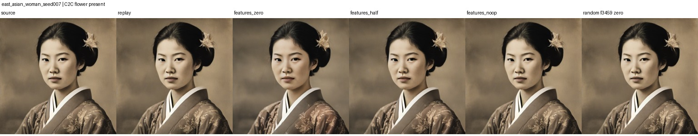
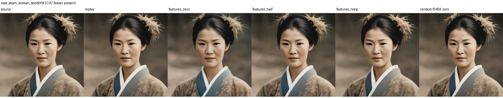
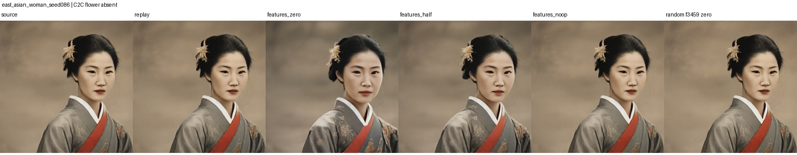

# First C2C box imitation run

Run date: 2026-10-12. The SDXL replay produced spatial residuals for all 1,200 images and verified exact RGB equality against each saved source image. Residual shape was `16 x 16 x 1280`. The train/validation/test split remained 720/240/240 images.

We trained the same 1x1 spatial box head in two settings for five epochs: the pretrained Top-K SAE frozen, and the SAE fine-tuned jointly with the head. Validation loss selected the fine-tuned checkpoint. Evaluation below uses the held-out 240 test images. Each target is the union of all matching C2C grounding/object boxes for one concept in an image. `mIoU` is averaged only over C2C-positive images; recall requires both confidence >= 0.5 and IoU >= 0.5.

| Concept | SAE | C2C positives / 240 | Objectness AP | Mean IoU on positives | Recall at score/IoU 0.5 |
|---|---|---:|---:|---:|---:|
| Kimono | Frozen | 21 | 0.932 | 0.575 | 0.524 |
| Kimono | Fine-tuned | 21 | 0.921 | 0.550 | 0.476 |
| Flower | Frozen | 13 | 0.799 | 0.035 | 0.000 |
| Flower | Fine-tuned | 13 | 0.840 | 0.087 | 0.000 |

The fine-tuned SAE did not improve kimono box quality. Flower objectness ranking improved slightly, but its boxes remain poorly localized: mean IoU is 0.087 and none reaches IoU 0.5. The frozen baseline performs similarly poorly on flower. Both systems rank presence above chance, but this does not mean they predict useful boxes.

These numbers measure agreement with C2C's unreviewed boxes. The flower test set has only 13 positives, and the SAE feature grid is coarse at 16 x 16. The model predicts one union box per image/concept, so it cannot reproduce multiple separate C2C boxes. This is a first pipeline result, not evidence of independent object detection or an improvement over C2C.

Artifacts are kept locally under the ignored `runs/` and `residuals/` folders: fine-tuned checkpoint `runs/c2c_box_sae_003`, frozen baseline `runs/frozen_sae_box_baseline_002`, and per-image predictions in each run's `test_predictions.csv`.

## Flower feature intervention test

Run date: 2026-10-12. We ranked SAE features by their contribution to the trained flower objectness head on the East Asian woman training subset (33 C2C-positive, 27 negative), then attenuated the top three features (940, 2810, 1855) during one-step SDXL generation. Evaluation used 20 held-out matched prompts: 12 C2C-positive and 8 C2C-negative. Every source image replayed with exact RGB equality. Strength 1 was an exact no-op. We compared strength 0 (zero the selected features), strength 0.5, and a zeroed activity-matched random feature (3459).

The target-feature ablation changed pixels substantially (mean RGB MAE 11.01/255 at strength 0, 6.21/255 at 0.5); the random-feature control averaged 1.52/255. Changes were similar for C2C-positive and negative examples, which suggests these features are not specific to flower presence. In the inspected C2C-positive examples, the flower hair ornament remained visible after ablation. The intervention altered other appearance details, including clothing and facial appearance. So this test did not remove the flower, despite changing the image.

### Example images

Each strip shows source, exact replay, selected flower features zeroed, features attenuated by half, the no-op check, and the random-feature control.

**C2C-positive example (seed 007):**

**C2C-positive example (seed 009):**

**C2C-negative example (seed 086):**

This is a small exploratory causal test using a learned detector head to select SAE features. C2C labels are assumed correct, and pixel MAE measures overall image change rather than flower removal. Per-image pixel metrics are in [`visualizations/flower_intervention_001/metrics.csv`](visualizations/flower_intervention_001/metrics.csv).
